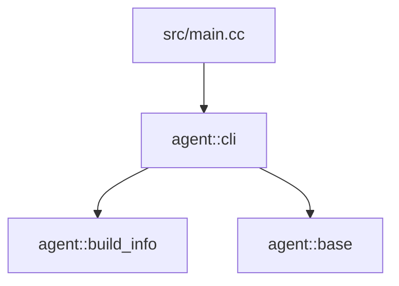

# Architecture

This page maps the [specification](spec.md) onto directories, CMake targets and modules and owns
their boundaries. Behavior lives in the specification; update this page in the same change that
adds a module, a target or an edge.

## Repository layout

```text
agent-cpp/
|-- CMakeLists.txt           project, version, options; includes cmake/ modules
|-- CMakePresets.json        host-{debug,asan,clang,cuda,release}, rpi5-*, luckfox-*
|-- Makefile                 every repository command (make help); includes make/*.mk
|-- make/                    config.mk (identity, target table), build, dist, quality, env; help.awk
|-- cmake/
|   |-- AgentTargets.cmake    agent_cc_library / agent_cc_binary / agent_cc_test
|   |-- AgentCompilerOptions.cmake  warnings, hardening, sanitizers, static linking
|   |-- AgentBuildBudget.cmake      build budget and Ninja job pools (compile, link, heavy), ccache
|   |-- AgentToolchainChecks.cmake  compiler floor
|   |-- AgentGoogleTest.cmake       pinned GoogleTest, test registration rules
|   |-- AgentCuda.cmake             optional CUDA language support
|   `-- toolchains/          rpi5.cmake, luckfox-pico.cmake, linux-gnu-cross.cmake
|-- src/
|   |-- main.cc              process wiring: argv to cli::Run, exit code
|   |-- base/                Status, StatusOr, AGENT_RETURN_IF_ERROR
|   |-- build_info/          build identity from CMake and compiler macros
|   `-- cli/                 command-line contract: commands, help, streams, exit codes
|-- tests/                   black-box tests of the built binary (CTest + run_cli.cmake)
|-- tools/
|   |-- plan.sh              plan status, plan lint, task-start and task-close (POSIX sh + awk)
|   |-- doc-links.sh         relative Markdown link and anchor check
|   |-- doctor.sh            installed tools against the floors
|   |-- setup-ubuntu.sh      system-wide apt toolchain install for Ubuntu 24.04 / 26.04
|   |-- tests/               shell tests of the tooling (make tools-test)
|   `-- docker/dev.Dockerfile  clean Ubuntu image for make matrix
|-- docs/design/             specification, architecture, ADRs, capability page template
|-- docs/impl/               plan.md, current.md, current/, records/
|-- docs/guide/              planning workflow, development, cross compilation, review checklist
|-- .github/workflows/       ci.yml (gates, cross, dist); release.yml (tag -> GitHub release)
|-- AGENTS.md                canonical agent rules; CLAUDE.md, GEMINI.md, .cursor/ point to it
`-- .clang-format, .clang-tidy, .editorconfig, .shellcheckrc
```

Add directories only when needed: `src/<module>/` for a module, `third_party/` for vendored
sources (with their licenses), `tests/fixtures/` for committed test inputs, `benchmarks/` for
Google Benchmark targets once the dependency table lists it.

## Dependency direction



- `main.cc` calls only `cli::Run`.
- `cli` is the only module that writes to the process streams, reads the environment or decides
  an exit code. It builds typed input and passes it down.
- `base` depends on nothing but the standard library; every module may use it.
- Domain modules never include `cli/`. Includes between modules follow the edges drawn here and
  the `DEPS` of their `agent_cc_*` calls; draw the edge before adding the include, and never
  create a cycle.
- `tests/` and `tools/` may use the public interface of any module; product code never depends
  on them.

## Build model

- Every first-party target is declared through `cmake/AgentTargets.cmake`, which applies the
  options in `AgentCompilerOptions.cmake` and the job pools in `AgentBuildBudget.cmake`. Library
  `agent_cc_library(NAME x ...)` becomes target `agent_x` with alias `agent::x`; link the alias.
- A preset fixes the build type, toolchain file, warnings-as-errors, sanitizers, static linking
  and the target name. Build trees are `build/<preset>/`; GoogleTest sources and builds are
  under `.cache/fetchcontent/<preset>/`.
- Cross presets use a board toolchain file that sets the compiler, CPU flags, find-root rules
  and `CMAKE_CROSSCOMPILING_EMULATOR`; product code has no target conditionals beyond
  `build_info`.
- A module that needs CUDA declares its targets with `CUDA` inside `if(AGENT_ENABLE_CUDA)` and
  exposes a plain C++ interface, so other modules and cross targets never see CUDA headers.

## Runtime model

- `main` turns `argv` into `std::string_view`s and passes them with `std::cout` and `std::cerr`
  to `cli::Run`, returning its exit code.
- `cli::Run` dispatches on the first argument: requested help and results go to stdout with
  `0`, usage errors to stderr with usage text and `2`, failures (a `Status` from a module or a
  failed write) to stderr with `1`.
- The process is synchronous and single-threaded. A capability that needs parallel work uses
  `std::jthread`s owned by the function that starts them and keeps output order deterministic.
